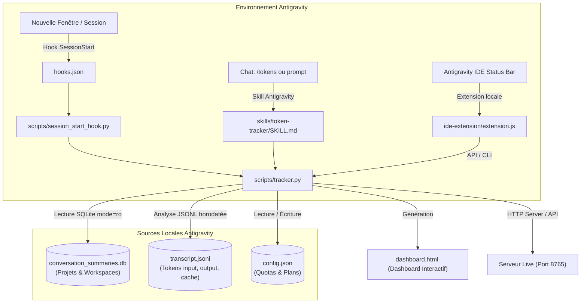

# ⚡ Antigravity Token Tracker

Un outil complet (Plugin, Skill, Extension IDE et Dashboard Web) pour **Google Antigravity** permettant de suivre, analyser et maîtriser votre consommation de tokens d'IA en temps réel : **fenêtre glissante 5h**, **limite hebdomadaire (Weekly)**, **consommation quotidienne & par heure**, et **détail par projet**.

[](https://github.com/Racem-H/antigravity-token-tracker)
[](LICENSE)
[](README.md)

---

## 🌟 Fonctionnalités Principales

### 1. ⏱️ Suivi des Limites Instantanées (Fenêtre Roulante 5h & Quota Hebdomadaire)
- **Sprint 5 Heures Glissantes** : Mesure exacte de votre consommation sur les 5 dernières heures glissantes (`now - 5h`) pour éviter d'atteindre la limite de débit instantanée.
- **Quota Hebdomadaire (Weekly Cap)** : Suivi précis du volume restant sur la semaine en cours (du lundi au dimanche) et jauge de progression visuelle.
- **Plans Préconfigurés & Personnalisés** :
  - **Google AI Starter** : 15M (5h) / 100M (Semaine)
  - **Google AI Pro** : 75M (5h) / 500M (Semaine)
  - **Google AI Ultra** : 250M (5h) / 1.5 Milliard (Semaine)
  - **Custom** : Limites entièrement personnalisables via CLI ou depuis l'interface web.

### 2. 📅 Décomposition par Semaine & Pourcentage Quotidien du Quota
- **Tableau Hebdomadaire Détaillé** : Affiche chaque semaine avec son total de tokens, son pourcentage d'utilisation de la limite de la semaine (`% de la limite weekly`), et les tokens restants.
- **Sous-lignes Quotidiennes** : Visualisez l'impact exact de chaque journée sur le quota hebdomadaire global.

### 3. 📊 Dashboard Graphique Interactif (`dashboard.html`)
- **Cartes KPI Héro** : Tokens restants sur 5h, Tokens restants sur la semaine, Total global, Coût estimé en USD, Économies de Cache.
- **Graphique par Heure (00h - 23h)** : Histogramme interactif montrant l'activité heure par heure pour chaque journée, avec détection de l'heure de pointe.
- **Graphique par Jour** : Évolution de la consommation au fil des jours.
- **Tableau par Projet / Workspace** : Analyse détaillée par dossier/projet (volume, pourcentage d'utilisation, input, output, cache read).
- **Modale de Configuration Intégrée** : Changez de forfait (Starter / Pro / Ultra) ou modifiez vos quotas directement dans l'interface avec sauvegarde instantanée.

### 4. 🖥️ Intégration Native Antigravity IDE (Status Bar)
- **Indicateur permanent** dans la barre d'état : `⚡ 5h: XXM · Hebdo: YYM restants`.
- **Survol (Hover)** : Affiche la synthèse complète (fenêtre 5h, hebdo, jour, cache, coût).
- **Menu 1-Clic & Raccourci `Ctrl+Alt+T`** : Ouvre le dashboard, rafraîchit les métriques ou change de forfait sans quitter l'éditeur.

### 5. 💬 Bannière Markdown Automatique & Commande `/tokens`
- **Hook `SessionStart`** : Affiche automatiquement une synthèse au lancement d'une nouvelle conversation.
- **Commande `/tokens`** : Invoquez à tout moment la skill pour inspecter vos quotas en cours de session.

---

## 🏗️ Architecture



---

## 📂 Structure du Répertoire

```text
antigravity-token-tracker/
├── install.bat                 # ⚡ Installateur universel Windows en 1 clic
├── install.ps1                 # Script d'installation PowerShell
├── open_dashboard.bat          # Lanceur rapide du dashboard dans le navigateur
├── open_dashboard.ps1          # Lanceur PowerShell du dashboard
├── config.json                 # Configuration des quotas et plans (Starter/Pro/Ultra)
├── plugin.json                 # Manifest officiel du plugin Antigravity
├── hooks.json                  # Hook de démarrage SessionStart
├── dashboard.html              # Tableau de bord interactif HTML5 / Tailwind
├── README.md                   # Documentation complète
├── PROJECT_HISTORY.md          # Historique technique et décisions d'architecture
├── scripts/
│   ├── tracker.py              # Moteur principal, calcul des quotas 5h/hebdo, serveur HTTP
│   └── session_start_hook.py   # Handler du hook SessionStart
├── ide-extension/
│   ├── package.json            # Manifest extension Antigravity IDE
│   └── extension.js            # Affichage barre d'état et commandes QuickPick
├── skills/
│   └── token-tracker/
│       └── SKILL.md            # Définition de la skill Antigravity
└── rules/
    └── AGENTS.md               # Règles globales de suivi pour l'agent
```

---

## 🚀 Installation Rapide (1 Clic)

### Méthode 1 : Installateur Automatique (Recommandé)
1. Clonez ce dépôt :
   ```bash
   git clone https://github.com/Racem-H/antigravity-token-tracker.git
   cd antigravity-token-tracker
   ```
2. Double-cliquez sur **`install.bat`** (ou lancez `.\install.ps1` dans PowerShell).
   - Lie automatiquement le plugin dans `~/.gemini/config/plugins/`
   - Active la skill globale dans `~/.gemini/config/skills/`
   - Active l'extension pour Antigravity IDE dans `~/.antigravity-ide/extensions/`
   - Génère votre premier tableau de bord personnalisé.

---

## ⚙️ Configuration des Quotas & Forfaits

Vous pouvez ajuster vos quotas à tout moment via la ligne de commande ou depuis le dashboard web :

### Sélection d'un Forfait Préconfiguré
```bash
# Sélectionner Google AI Pro (75M 5h / 500M Semaine)
python scripts/tracker.py --set-plan "Google AI Pro"

# Sélectionner Google AI Ultra (250M 5h / 1.5B Semaine)
python scripts/tracker.py --set-plan "Google AI Ultra"

# Sélectionner Google AI Starter (15M 5h / 100M Semaine)
python scripts/tracker.py --set-plan "Google AI Starter"
```

### Définir des Quotas Personnalisés
```bash
# Modifier la limite 5h (supporte M pour Millions, B pour Milliards)
python scripts/tracker.py --set-5h-quota 80M

# Modifier la limite hebdomadaire
python scripts/tracker.py --set-weekly-quota 600M

# Modifier la limite quotidienne indicative
python scripts/tracker.py --set-daily-quota 120M
```

---

## 💻 Utilisation CLI

- **Afficher le résumé instantané dans le terminal** :
  ```bash
  python scripts/tracker.py --summary
  ```
- **Afficher la bannière Markdown (format Chat Antigravity)** :
  ```bash
  python scripts/tracker.py --markdown
  ```
- **Régénérer le dashboard HTML avec les données locales** :
  ```bash
  python scripts/tracker.py --html
  ```
- **Démarrer le serveur dynamique (avec API de config et rechargement en direct)** :
  ```bash
  python scripts/tracker.py --serve --port 8765
  ```
- **Générer un dashboard démo anonymisé (pour capture ou commit public)** :
  ```bash
  python scripts/tracker.py --demo
  ```

---

## 💰 Modèle de Calcul des Coûts
Les coûts indicatifs sont calculés sur la base des tarifs standard **Gemini 2.0 Flash / Pro** :
- **Prompt (Input)** : $0.075 / 1 Million de tokens
- **Génération (Output)** : $0.30 / 1 Million de tokens
- **Context Caching (Lecture de Cache)** : $0.01875 / 1 Million de tokens (~75% d'économie)

---

## 🤝 Contribution & Licence

Les contributions sont les bienvenues ! N'hésitez pas à ouvrir une Issue ou une Pull Request pour proposer de nouvelles fonctionnalités ou des améliorations visuelles.

Ce projet est sous licence **MIT**.