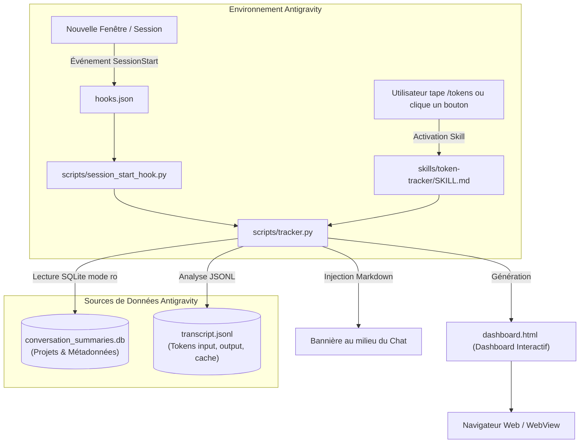

# ⚡ Antigravity Token Tracker

Un plugin et une skill pour **Google Antigravity** permettant de suivre, analyser et visualiser votre consommation de tokens d'IA en temps réel : **par jour**, **par heure**, et **par projet (workspace)**.

---

## 🌟 Fonctionnalités

1. **🖥️ Affichage automatique au démarrage (`SessionStart` Hook)** :
   - Dès que vous ouvrez une **nouvelle fenêtre** ou démarrez une nouvelle conversation dans Antigravity, un bandeau visuel synthétique s'affiche **au milieu du chat** avec votre consommation du jour, l'heure actuelle, le projet actif et un bouton pour ouvrir le dashboard.

2. **🔘 Bouton d'accès en 1 clic pendant le travail sur un projet ou un fichier** :
   - **Bouton d'action dans le chat** : Cliquez sur les suggestions de prompts intégrées ou sur le lien `[📊 Ouvrir le Dashboard Graphique]`.
   - **Raccourci exécutable sur le Bureau** : Double-cliquez sur `📊 Antigravity Tokens.bat` sur votre bureau ou sur `open_dashboard.bat` dans ce dossier pour ouvrir instantanément le tableau de bord dans votre navigateur.
   - **Tâche IDE (VS Code / Antigravity IDE)** : Lancez la tâche `📊 Antigravity: Voir les Tokens` via `Ctrl+Shift+B`.
   - **Commande `/tokens`** : Tapez simplement `/tokens` dans Antigravity pour réactualiser les métriques.

3. **📈 Dashboard Graphique Interactif (`dashboard.html`)** :
   - **Cartes KPI** : Total Tokens, Input (Prompt), Output (Génération), Cache Read Tokens, Coût estimé en USD, Total des appels.
   - **Graphique par Heure (00h - 23h)** : Histogramme interactif montrant l'activité heure par heure pour chaque journée, avec détection de l'heure de pointe.
   - **Graphique par Jour** : Évolution de la consommation au fil des jours.
   - **Tableau par Projet** : Analyse détaillée par dossier/workspace (pourcentage de consommation globale, appels, répartition input/output/cache, coût).
   - **Filtres interactifs** : Sélecteur de date, recherche textuelle de projets, rafraîchissement en direct.

---

## 🏗️ Architecture du Projet



---

## 📂 Structure des Fichiers

```text
C:\Users\medra\Desktop\antigravity-token-tracker/
├── plugin.json                 # Manifest officiel du plugin Antigravity
├── hooks.json                  # Hook de démarrage de session (SessionStart)
├── dashboard.html              # Tableau de bord HTML/Tailwind interactif
├── open_dashboard.bat          # Lanceur Windows 1-clic (ouvre le dashboard)
├── open_dashboard.ps1          # Lanceur PowerShell
├── README.md                   # Documentation complète
├── PROJECT_HISTORY.md          # Journal de bord et décisions techniques
├── .gitignore                  # Fichiers exclus de Git
├── .vscode/
│   └── tasks.json              # Raccourci tâche IDE (Ctrl+Shift+B)
├── scripts/
│   ├── tracker.py              # Moteur principal d'analyse des tokens & serveur HTTP
│   └── session_start_hook.py   # Script exécuté par le hook de démarrage
├── skills/
│   └── token-tracker/
│       └── SKILL.md            # Définition de la skill Antigravity
└── rules/
    └── AGENTS.md               # Instructions globales pour l'agent
```

---

## 🚀 Installation & Activation

### 1. Liaison automatique avec Antigravity
Le dossier du plugin sur le Bureau est lié directement dans la configuration globale d'Antigravity :
```powershell
New-Item -ItemType Junction -Path "$HOME\.gemini\config\plugins\antigravity-token-tracker" -Target "C:\Users\medra\Desktop\antigravity-token-tracker"
```

Antigravity détecte immédiatement le plugin sans avoir besoin de redémarrer.

### 2. Utilisation en Ligne de Commande (CLI)
- **Résumé rapide dans le terminal** :
  ```powershell
  python scripts/tracker.py --summary
  ```
- **Générer / Mettre à jour le dashboard HTML** :
  ```powershell
  python scripts/tracker.py --html
  ```
- **Lancer le serveur live local (auto-refresh)** :
  ```powershell
  python scripts/tracker.py --serve --port 8765
  ```

---

## 📤 Pousser ce projet sur votre Dépôt Git (GitHub / GitLab)

Le dépôt Git local est initialisé directement dans ce dossier sur le Bureau.

Pour le publier sur votre compte GitHub :

1. **Créez un nouveau dépôt vide sur GitHub** (par exemple nommé `antigravity-token-tracker`).
2. **Liez votre dépôt distant et poussez vos fichiers** :
   ```bash
   cd "C:\Users\medra\Desktop\antigravity-token-tracker"
   git remote add origin https://github.com/Racem-H/antigravity-token-tracker.git
   git branch -M main
   git push -u origin main
   ```

---

## 💰 Modèle de Calcul des Coûts
Les coûts estimés sont calculés selon la grille standard **Gemini 1.5/2.0 Flash** :
- **Input (Prompt)** : \$0.075 pour 1 million de tokens
- **Output (Génération)** : \$0.30 pour 1 million de tokens
- **Context Caching (Cache)** : \$0.01875 pour 1 million de tokens (75% d'économie)

---

## 👤 Auteur
- **Développeur** : Racem-H
- **Email** : med.racem@gmail.com
